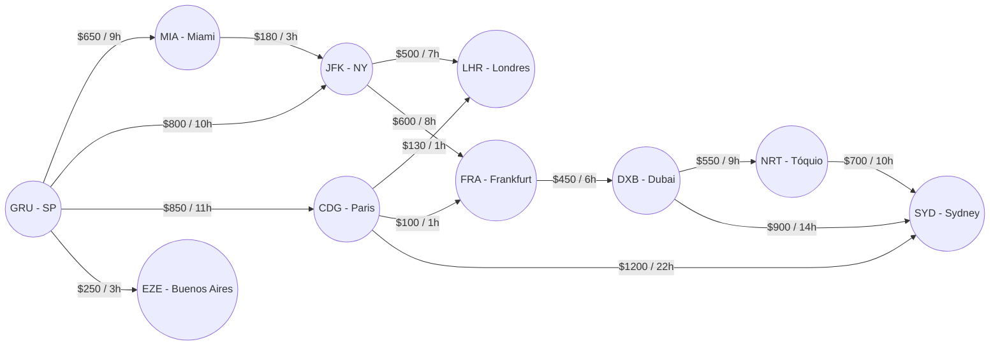
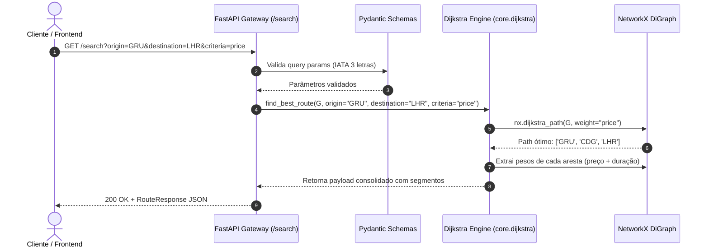

# ✈️ AirCrazyScarello — Flight Route Optimization Engine

[](https://python.org)
[](https://fastapi.tiangolo.com)
[](https://networkx.org/)
[](https://docs.pydantic.dev/)
[](https://pytest.org)
[](LICENSE)

Uma API REST de alta performance desenvolvida em **FastAPI** e **NetworkX**, projetada para resolver o problema clássico de roteamento de menor caminho (**Shortest Path Problem**) em malhas aéreas internacionais utilizando o **Algoritmo de Dijkstra**.

A engine permite calcular trajetos multitrecho otimizados dinamicamente por **menor custo financeiro (preço)** ou **menor tempo de deslocamento (duração)**, retornando conexões detalhadas, paradas intermediárias e métricas completas da viagem.

---

## 🏛️ Teoria da Computação & Arquitetura

O sistema modela a malha de aviação como um **Grafo Direcionado Ponderado (Weighted DiGraph)**:
- **Vértices / Nós ($V$)**: Aeroportos identificados pelo código IATA (ex: `GRU`, `JFK`, `LHR`, `CDG`, `DXB`).
- **Arestas Direcionadas ($E$)**: Trechos de voos comerciais conectando dois aeroportos com pesos independentes:
  - $w_{price}$: Tarifa do trecho em USD ($).
  - $w_{duration}$: Duração estimada do voo em horas ($h$).



### 🧠 Como Funciona o Algoritmo de Dijkstra

Dado um aeroporto de origem $s \in V$ e um destino $t \in V$, o algoritmo mantém uma estimativa de menor distância para cada nó e expande iterativamente o vértice de menor peso acumulado ainda não visitado (usando uma fila de prioridade / heap):

$$\operatorname{dist}[v] = \min(\operatorname{dist}[v], \operatorname{dist}[u] + w(u, v))$$

* Ao selecionar o critério `price`, a função custo minimiza $\sum w_{price}$.
* Ao selecionar o critério `duration`, a função custo minimiza $\sum w_{duration}$.

---

## 🔄 Fluxo de Execução da API



---

## ⚡ Exemplos de Uso

### 1. Consultar a melhor rota (GRU ➔ LHR por menor preço)
```bash
curl -X GET "http://127.0.0.1:8000/search?origin=GRU&destination=LHR&criteria=price"
```

**Resposta JSON (200 OK):**
```json
{
  "origin": "GRU",
  "destination": "LHR",
  "criteria": "price",
  "path": ["GRU", "CDG", "LHR"],
  "segments": [
    {
      "from_airport": "GRU",
      "to_airport": "CDG",
      "price": 850,
      "duration": 11
    },
    {
      "from_airport": "CDG",
      "to_airport": "LHR",
      "price": 130,
      "duration": 1
    }
  ],
  "total_price": 980,
  "total_duration": 12,
  "stops": 1
}
```

### 2. Consultar detalhes de um aeroporto
```bash
curl -X GET "http://127.0.0.1:8000/airports/GRU"
```
```json
{
  "iata": "GRU",
  "city": "Sao Paulo",
  "country": "Brazil"
}
```

---

## 🚀 Como Executar Localmente

### Pré-requisitos
* Python 3.10+
* Git

### 1. Clonar o repositório:
```bash
git clone https://github.com/DouglasScarello/AirCrazyScarello.git
cd AirCrazyScarello
```

### 2. Criar e ativar o ambiente virtual:
```bash
python -m venv venv
source venv/bin/activate  # Linux/macOS
# venv\Scripts\activate   # Windows
```

### 3. Instalar dependências:
```bash
pip install -r requirements.txt
```

### 4. Iniciar a API:
```bash
uvicorn backend.app:app --reload
```
* **Swagger interativo (OpenAPI):** http://127.0.0.1:8000/docs
* **ReDoc alternativo:** http://127.0.0.1:8000/redoc

---

## 🧪 Executando os Testes Automatizados

O projeto conta com testes unitários do algoritmo e testes de integração de todos os endpoints HTTP:

```bash
pytest -v
```

---

## 📁 Estrutura do Repositório

```text
AirCrazyScarello/
├── backend/
│   ├── __init__.py           # Package marker
│   ├── app.py                # Rotas da API, middleware CORS e tratamento de exceções
│   └── schemas.py            # Modelos de dados e validação estrita com Pydantic V2
├── core/
│   ├── __init__.py           # Package marker
│   ├── dijkstra.py           # Algoritmo de Dijkstra com suporte a múltiplos critérios
│   ├── exceptions.py         # Exceções customizadas de domínio (404, NoRouteFound)
│   └── graph.py              # Parser de CSVs e construtor do DiGraph com NetworkX
├── data/
│   ├── airports.csv          # Base cadastral de aeroportos (IATA, Cidade, País)
│   └── flights.csv           # Malha de voos com custos e tempos de voo
├── tests/
│   ├── __init__.py
│   ├── test_api.py           # Testes de integração dos endpoints FastAPI
│   └── test_dijkstra.py      # Testes unitários do cálculo de menor caminho
├── .gitignore                # Arquivos ignorados pelo Git
├── requirements.txt          # Dependências do projeto
└── README.md                 # Documentação completa
```

---

## ⚖️ Licença

Distribuído sob a licença **MIT**.

Desenvolvido por **[Douglas Scarello](https://github.com/DouglasScarello)** 🚀
