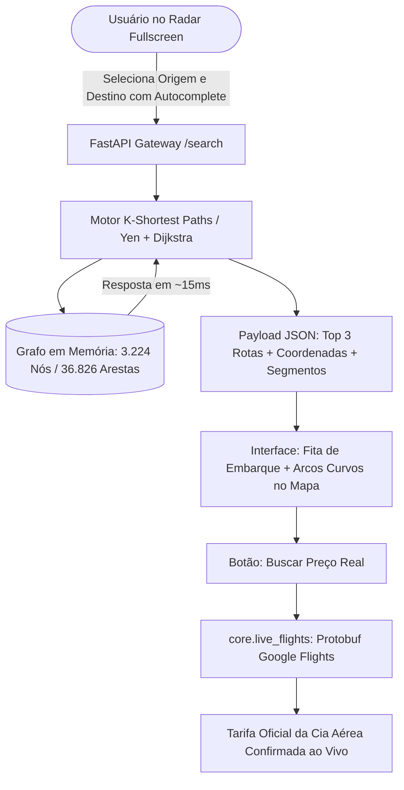

# 🌐 AeroGraph — Global Flight Navigation Engine & Tactical Radar

[](https://python.org)
[](https://fastapi.tiangolo.com)
[](https://networkx.org/)
[](https://en.wikipedia.org/wiki/Dijkstra%27s_algorithm)
[](https://leafletjs.com/)
[](LICENSE)

O **AeroGraph** é uma engine de alta performance para resolução do **Problema do Menor Caminho (Shortest Path Problem)** aplicada à aviação comercial global. 

O sistema compila **3.224 aeroportos** e **36.826 rotas comerciais ativas** em uma estrutura de dados de **Grafo Direcionado Ponderado (`DiGraph`) em memória RAM**, calculando trajetórias intercontinentais ótimas e as **Top 3 Alternativas Simultâneas (Algoritmo de Yen)** em **menos de 15 milissegundos**. O projeto inclui um **Radar Cartográfico Geodésico Fullscreen** (estilo Google Maps / GTA), conversor multimoedas em tempo real e integração direta com o **Google Flights**.

---

## 💡 Sobre o Nome e Conceito

> **AeroGraph** nasce da fusão direta entre **Aeronáutica** e **Teoria dos Grafos** (*Graph Theory*). 
> O projeto foi batizado para refletir uma abordagem estritamente focada em engenharia de software e ciência da computação pura: tratar o tráfego aéreo planetário não como simples tabelas de banco de dados, mas como uma rede vetorial ponderada de conexões geométricas e econômicas.

---

## 🏛️ Destaques de Engenharia & Ciência da Computação

Diferente de agregadores comerciais convencionais que realizam queries pesadas e lentas em bancos relacionais com filtros heurísticos opacos, o **AeroGraph** baseia-se em algoritmos com prova matemática formal:

* **In-Memory Graph Engine (`NetworkX`)**: Toda a malha aeroviária comercial mundial opera carregada em memória RAM. Complexidade de busca ótima $O((V + E) \log V)$ utilizando Heap de Prioridade Mínima.
* **Top 3 Alternativas Simultâneas (Algoritmo de Yen - K-Shortest Paths)**: O sistema não obriga o usuário a escolher filtros cegos. Ele calcula simultaneamente:
  * 🟢 **Mais Econômica:** A rota de menor custo financeiro absoluto da malha mundial.
  * 🔵 **Mais Rápida:** A rota de menor duração acumulada de voo.
  * 🟡 **Custo-Benefício:** A melhor alternativa de conexão intermediária viável.
* **Geodésica Real da Terra (Fórmula de Haversine)**: Cálculo da curvatura do globo terrestre a partir de latitude e longitude reais de cada pista para determinação de distâncias ortodrômicas e custos paramétricos padrão IATA/CASM.
* **Radar Tático Fullscreen com Traçado em Arcos**: Visualização em tela cheia com aglomeração dinâmica de aeroportos (Leaflet MarkerCluster) e curvas geodésicas de voo (Great Circle Arcs).
* **Cotação Real em Tempo Real (Google Flights Engine)**: Módulo em Python (`core/live_flights.py`) que decodifica parâmetros Protocol Buffers (Protobuf) e consulta tarifas oficiais de cias aéreas em tempo real, sem necessidade de chaves de API pagas ou cadastros.

---

## 🔄 Fluxo e Arquitetura do Sistema



---

## ⚡ Exemplo Real: Florianópolis (FLN) ➔ Albany, Austrália (ALH)

O algoritmo identifica a rota geodésica real mais inteligente do planeta (atravessando o Hemisfério Sul pelo continente africano):

```text
Trajeto Calculado (23h de viagem | R$ 9.677):
FLN (Florianópolis) ➔ GRU (São Paulo) ➔ JNB (Joanesburgo) ➔ PER (Perth) ➔ ALH (Albany)
```

---

## 💱 Suporte Multimoedas em Tempo Real

A interface converte instantaneamente todos os preços e segmentos sem recarregar a busca:
* 🇧🇷 **Real Brasileiro (`BRL R$`)**
* 🇺🇸 **Dólar Americano (`USD $`)**
* 🇪🇺 **Euro (`EUR €`)**
* 🇬🇧 **Libra Esterlina (`GBP £`)**

---

## 🚀 Como Executar Localmente

### Pré-requisitos
* **Python 3.10+**
* **Git**

### Passo a Passo

1. **Clonar o repositório:**
   ```bash
   git clone https://github.com/DouglasScarello/AeroGraph.git
   cd AeroGraph
   ```

2. **Criar e ativar o ambiente virtual:**
   ```bash
   python -m venv venv
   source venv/bin/activate  # Linux/macOS
   # venv\Scripts\activate   # Windows
   ```

3. **Instalar dependências:**
   ```bash
   pip install -r requirements.txt
   ```

4. **Iniciar o servidor:**
   ```bash
   uvicorn backend.app:app --host 0.0.0.0 --port 8008 --reload
   ```

5. **Acessar no navegador:**
   * **Radar Fullscreen:** [http://127.0.0.1:8008/](http://127.0.0.1:8008/)
   * **Swagger OpenAPI:** [http://127.0.0.1:8008/docs](http://127.0.0.1:8008/docs)

---

## 🧪 Testes Automatizados

Suíte completa com testes unitários da teoria dos grafos e testes de integração dos endpoints HTTP via `TestClient`:

```bash
pytest -v
```

---

## 📁 Estrutura do Repositório

```text
AeroGraph/
├── backend/
│   ├── app.py                # Rotas REST, middleware CORS e inicialização da API
│   └── schemas.py            # Validação e serialização estrita com Pydantic V2
├── core/
│   ├── dijkstra.py           # Algoritmos de Dijkstra e Yen (K-Shortest Paths)
│   ├── exceptions.py         # Exceções de domínio (AirportNotFoundError, NoRouteFound)
│   ├── graph.py              # Construtor do Grafo Direcionado em memória com NetworkX
│   └── live_flights.py       # Extração de tarifas reais via Protobuf (Google Flights)
├── data/
│   ├── airports.csv          # 3.224 aeroportos comerciais com coordenadas geográficas
│   └── flights.csv           # 36.826 rotas ativas com pesos paramétricos
├── frontend/
│   └── index.html            # Aplicação web fullscreen com Leaflet Dark e Autocomplete
├── tests/
│   ├── test_api.py           # Testes de integração dos endpoints FastAPI
│   └── test_dijkstra.py      # Testes unitários do cálculo de menor caminho
├── requirements.txt          # Dependências do ecossistema
└── README.md                 # Documentação técnica do projeto
```

---

## ⚖️ Licença

Distribuído sob a licença **MIT**. Consulte o arquivo `LICENSE` para mais informações.

Desenvolvido por **[Douglas Scarello](https://github.com/DouglasScarello)** 🚀
